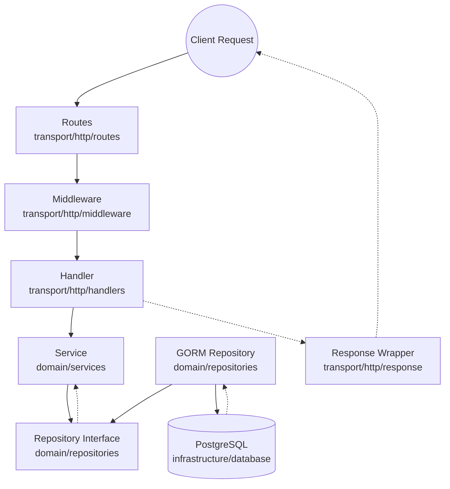

# Go-Gin Template Architecture

This template is built using Clean Architecture principles, specifically tailored for Go. It groups files by technical responsibility (App, Domain, Infrastructure, Transport) rather than clumping everything into a flat structure.

## 📂 Directory Structure

```text
go-gin-template-v1/
│
├── cmd/
│   └── api/
│       └── main.go                 # Application entrypoint (Wires dependencies)
│
├── internal/
│   │
│   ├── app/                        # Startup & Configuration
│   │   ├── config/
│   │   └── bootstrap/              # (Future) App initialization
│   │
│   ├── domain/                     # Business Logic (The Core)
│   │   ├── models/                 # Data structs & schema (Prisma equivalent)
│   │   ├── repositories/           # Repository interfaces & logic
│   │   ├── services/               # Core business rules
│   │   └── apperrors/              # Typed domain errors
│   │
│   ├── infrastructure/             # External Systems
│   │   ├── database/               # PostgreSQL & GORM setup
│   │   ├── redis/                  # Redis caching setup
│   │   └── security/               # Cryptography (JWT, Bcrypt)
│   │
│   └── transport/                  # HTTP / API Layer
│       └── http/
│           ├── handlers/           # Controllers (Validation, Response formatting)
│           ├── middleware/         # Request interceptors (Auth, CORS, Recovery)
│           ├── routes/             # Router grouping and setup
│           └── response/           # Standard JSON response wrappers
│
├── Dockerfile                      # Multi-stage Docker build
├── docker-compose.yml              # Spins up API + Postgres + Redis
├── go.mod & go.sum                 # Dependencies
└── .env                            # Local environment variables
```

---

## 🔄 The Request Lifecycle

The golden rule of Clean Architecture is that inner layers (`domain`) cannot depend on outer layers (`transport` or `infrastructure`).



---

## 🧱 Layer Responsibilities

### 1. `transport` (The API)
Everything related to HTTP lives here.
- **`handlers`**: Parses JSON to DTOs, calls the Domain, formats the JSON response. Handlers NEVER write SQL or run business rules.
- **`routes`**: Maps URLs to Handlers.
- **`middleware`**: Intercepts requests (CORS, Auth, Logging).
- **`response`**: Standardizes output.

### 2. `domain` (The Business)
The pure Go heart of the application. It knows nothing about HTTP or the Database.
- **`models`**: Structs defining the domain entities (e.g., `User`, `Account`).
- **`services`**: Executes business rules (e.g., "Cannot register if email exists").
- **`repositories`**: Interfaces defining data access (e.g., `UserRepository`).
- **`apperrors`**: Typed domain errors (e.g., `ErrUserNotFound`).

### 3. `infrastructure` (The Tech)
How the app talks to the outside world.
- **`database`**: The concrete GORM/Postgres connection logic.
- **`redis`**: Cache connection logic.
- **`security`**: Hash algorithms and token signing.

### 4. `app` (The Glue)
Configuration and bootstrapping. It reads `.env` variables and wires the `infrastructure`, `domain`, and `transport` together in `cmd/api/main.go`.
